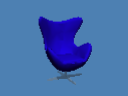
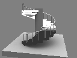
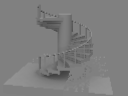
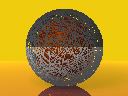
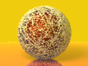
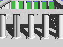
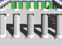

# Legacy scene migration

Related to [#27](https://github.com/thabz/RayGay/issues/27).

`gay2scm.py` is a strict Python 3 converter for the legacy scene corpus. It
accepts the old stream importer syntax and the later brace-based DSL, including
mixed files. Original `.gay` files remain unchanged. Generated files require a
binary built from this change.

**Current result: 13 of 20 scenes convert and load. Seven remain blocked.**
See [the per-file report](../../scenes/migrated/report.json). Loading proves that
Scheme executes the file; it does not prove that the old and new renderers produce
identical scenes or images. The report deliberately leaves `semantic_verified`
false for source scenes pending full equivalence review.

## Running the tools

From the repository root:

```sh
python3 scripts/gay2scm.py scenes --output-dir /tmp/converted --check --report /tmp/check.json
python3 scripts/gay2scm.py scenes --output-dir scenes/migrated --report scenes/migrated/report.json
cmake -S . -B build -G Ninja -DCMAKE_BUILD_TYPE=Release
cmake --build build
ctest --test-dir build --output-on-failure
python3 scripts/validate_migration.py scenes/migrated/report.json --probe build/migration_probe
```

Batch commands return nonzero when any file is blocked, while reporting every
file. The second command is an example for a fresh destination: committed outputs
already exist and **will not be overwritten**. Use a new destination for subsequent
runs. `--check` does not create output directories or scene files; an explicitly
requested report is still written. Output publication is atomic and exclusive.
Includes are expanded, cycles are rejected, and texture paths are rewritten relative
to the output. The generated library load path is also relative, so moving output
outside its original directory requires regeneration.

The validator independently loads each generated file through `SceneParser` and
records camera position, dimensions, light/object counts, the first 16 primitive
bounds and the first primitive's material coefficients. Optional
`--renderer build/raygay --preview-dir /tmp/previews` renders at width 128 using
one thread and seed 1, preserving the scene's original AA settings. Each subprocess
has a timeout (180 seconds by default). Rendering success is recorded separately
from loading and semantic equivalence. Run validation from the repository root.

## Translation and tests

The converter tokenizes and recursively parses source constructs; it does not
replace keywords with regular expressions. Scheme `let*` bindings preserve
expression evaluation order. Scalar and vector variables have distinct namespaces,
all numeric expressions use double precision, assignments remain mutable, repeat
counts are evaluated once and truncated, and `do/while` executes at least once.
Negative repeat counts raise an exception, as in the old interpreter.

Named objects are copied before transformation. Groups collect objects locally,
then flatten only where the target API requires it. Rotation/translation/scale
order follows the original source. Literal mesh vectors stay compact; expressions
inside vectors are evaluated at runtime.

The small API additions are `scene-object-copy`, `make-superellipsoid`,
`legacy-blob` (sphere atoms with a common weight) and `legacy-repeat-count`.
Extrusions use the original circular cross-section and twist value of 5. The
historical materials include is bundled in `scripts/legacy/materials.gay`;
only referenced plastic definitions are emitted, with their original coefficients.
Unrelated texture/material dependencies are not loaded. Nonplastic or unsupported
material definitions fail explicitly.

`testmigration` runs the complete 20-file inventory against the real runtime,
plus independent fixtures checking arithmetic, floating division, vector/scalar
namespaces, random ranges, both syntaxes, loop bounds, camera and image settings,
material coefficients, clone isolation, transformed bounding boxes, ray hits and
normals. Numeric geometry checks use an absolute tolerance of `1e-8` plus relative
`1e-6`; the sphere hit fixture uses `1e-6`. Tests also cover cyclic includes,
check-only operation, diagnostics and refusing existing outputs.

## Historical evidence and visual review

The block grammar and interpreter reference is commit
`d6ec6b2baa5388fab032b8c2267184978c2f17ad` (immediately before the Scheme merge).
The earlier flat importer reference is
`c0d3ae751bdc64ead1a860b47df550cfc29c447e`, `src/importer.cpp`.
The bundled materials come from the block reference commit's `scenes/materials.gay`.

The historical reference build is reproducible on this macOS host with Autoconf,
Automake, Libtool, Flex, Bison and a C++ compiler:

```sh
python3 scripts/legacy/build_reference.py /tmp/raygay-reference
# Pillow is required only for encoding the review PNGs.
python3 scripts/preview_migration.py \
  --reference /tmp/raygay-reference/src/tracer \
  --renderer build/raygay --output-dir docs/migration/previews
```

The builder exports the pinned Git tree into a new directory, fixes obsolete C++
declarations and missing includes, fixes the generated parser header dependency,
and builds only the headless renderer. It does not alter geometry or shading.
No files in the current worktree are used as historical renderer source.

Both sides below use width 128, aspect 4:3, AA 0, one thread and seed 1. For the
historical parser only, whitespace-separated *literal* vectors are given commas:
the old Bison grammar otherwise fails on negative mesh coordinates. This is a
syntax normalization, preserving every coordinate. The source files are unchanged.

| Scene | Before: historical `.gay` renderer | After: generated Scheme |
| --- | --- | --- |
| Egg chair |  |  |
| Staircase |  |  |
| Elastic ball |  |  |
| Greek temple |  |  |

**These are review comparisons, not pixel-equality passes.** Geometry is visually
comparable, but lighting/shading differs substantially between renderer versions,
especially on the chair and staircase. Their prepared kd-tree primitive counts
agree (2,894; 2,056; 240,002; 1,020 respectively). This is useful structural evidence,
but does not establish full equivalence. Top-level scene counts differ because
Scheme flattens groups; comparing those counts directly would be misleading.
Image hashes and primitive counts are recorded in [the preview manifest](previews/manifest.json).

## Remaining blockers

| Scene | Reason |
| --- | --- |
| `3ds/objects.gay` | A fragment requiring a predefined material and the removed 3DS importer. No substitute mesh is invented. |
| `old/57chevy.gay` | Missing `probes/TG_Probe01.hdr`. |
| `old/testscene.gay` | Missing `probes/grace_probe.hdr`. |
| `old/rubrik.gay` | Legacy `settings { paths 100 }` has no current equivalent. |
| `old/sor.gay` | The flat importer constructs `points_num` zero points and then appends its input. A compatibility decision is needed before translating that behavior. |
| `old/specularbloom.gay` | The current scene API does not expose the legacy filter stack; its environment texture is also absent. |
| `old/swamp.gay` | The current scene API does not expose fog; further asset checks await a supported translation. |

No blocked scene receives a partial `.scm` file. The report records the first
blocking construct, rather than claiming an exhaustive diagnosis. Consequently
this PR advances #27 but does not close it.
